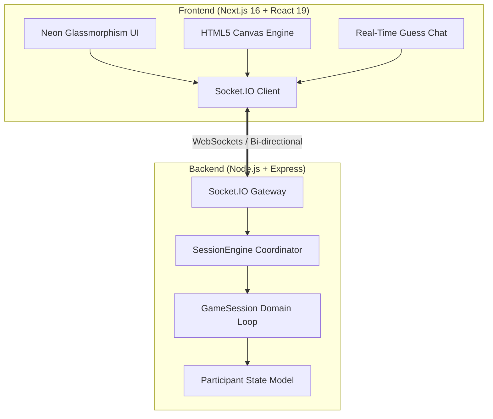

<div align="center">

# 🎨 Skribbl.io Clone — Real-Time Multiplayer Drawing & Guessing Game

<p align="center">
  <strong>A high-performance, full-stack multiplayer drawing and guessing game built with Next.js, HTML5 Canvas, Node.js, and Socket.IO.</strong>
</p>

[](https://my-project-psi-plum-82.vercel.app/)
[](https://github.com/sachin4726)
[](https://github.com/sachin4726)
[](https://nextjs.org/)
[](https://react.dev/)
[](https://nodejs.org/)
[](https://socket.io/)
[](https://tailwindcss.com/)

<p align="center">
  🚀 <strong>Live Demo:</strong> <a href="https://my-project-psi-plum-82.vercel.app/" target="_blank"><strong>https://my-project-psi-plum-82.vercel.app/</strong></a>
</p>

---

</div>

## 🌟 Overview

The **Skribbl.io Clone** is a real-time multiplayer drawing and word-guessing web application. Designed and built from the ground up by **[Sachin Kumar](https://github.com/sachin4726)**, the game delivers an authentic Skribbl experience with a sleek neon glassmorphism user interface, sub-second canvas synchronization across rooms, dynamic turn rotations, time-weighted scoring calculations, and an authoritative Object-Oriented game engine.

---

## 👨‍💻 Project Author & Developer

<div align="center">
  <table>
    <tr>
      <td align="center">
        <a href="https://github.com/sachin4726">
          <br />
          <sub><b>Sachin Kumar</b></sub>
        </a>
        <br />
        <i>Software Developer | Building useful things | Always learning</i>
        <br /><br />
        <a href="https://github.com/sachin4726" title="GitHub">
          
        </a>
        &nbsp;
        <a href="https://www.linkedin.com/in/sachin4726/" title="LinkedIn">
          
        </a>
      </td>
    </tr>
  </table>
</div>

---

## 📸 Application Showcase

### 1. Room Lobby & Session Configuration
Configure rounds (2–10), draw duration (15–240s), and maximum player capacity (2–20), or join any room with a unique room code.

<p align="center">
  
</p>

### 2. Live Canvas Synchronization & Real-Time Guessing Chat
Draw with smooth low-latency stroke broadcast, color selectors, and brush sizes while players submit guesses in the live chat with instant word-match scoring.

<p align="center">
  
</p>

### 3. Victory Screen & Match Leaderboard
Final scores are tallied and displayed with interactive podium placement and celebratory match summaries.

<p align="center">
  
</p>

---

## 🚀 Key Features

- **🎮 Multiplayer Room Management:**
  - Dynamic room generation with unique codes.
  - Custom configurable game parameters: rounds (2–10), draw time (15–240s), and player limits (2–20).
  - Real-time player presence tracking with host assignment and lobby updates.

- **🖌️ High-Performance HTML5 Canvas Engine:**
  - Sub-millisecond continuous stroke interpolation using normalized coordinate pairs `(x0, y0, x1, y1)`.
  - Rich color palette picker and adjustable brush widths.
  - Multi-step canvas undo history via Base64 snapshot stacks.
  - One-click clear canvas functionality synchronized across all room participants.

- **⏱️ Strict Turn-Based Game Loop:**
  - 15-second secret word selection phase (3 random options presented to the drawer).
  - Synchronized countdown turn timers managed authoritatively by the backend.
  - Turn rotation ensuring every participant draws once per round.

- **🎯 Dynamic Time-Decay Scoring Engine:**
  - Fast guessers earn higher points according to the speed formula:
    $$\text{Points} = \left\lfloor \frac{\text{timeLeft}}{\text{totalTime}} \times 500 \right\rfloor + 100$$
  - Drawer earns bonus points when players successfully identify the drawing.

- **💬 Real-Time Chat & Guess Validation:**
  - Real-time Socket.IO chat stream with automated guess filtering.
  - Hidden answer detection prevents spoiling the secret word in the room chat once guessed correctly.

- **✨ Neon Glassmorphism UI:**
  - Futuristic dark neon design system built with Tailwind CSS v4.
  - Fully responsive layout optimized across desktop, tablet, and mobile browsers.

---

## 🏗️ System Architecture



---

## 📦 Project Structure

```text
Sachin-frontend/
├── public/                     # Static assets and icons
├── src/
│   ├── app/
│   │   ├── room/
│   │   │   └── [id]/
│   │   │       └── page.tsx    # Live Game Arena (Canvas, Chat, Players, Timers)
│   │   ├── favicon.ico
│   │   ├── globals.css         # Global styles & Tailwind v4 theme tokens
│   │   ├── layout.tsx          # Root Next.js layout & SEO metadata
│   │   └── page.tsx            # Main Lobby & Session Configurator
│   └── lib/
│       └── socket.ts           # Socket.IO client instance singleton
├── Sachin-backend/
│   ├── src/
│   │   ├── coordinators/
│   │   │   └── SessionEngine.js # Room registry & connection router
│   │   ├── domain/
│   │   │   ├── GameSession.js   # Authoritative game state machine & timers
│   │   │   └── Participant.js   # Player model (score, socket ID, status)
│   │   └── main.js              # Express server & Socket.IO event hub
│   ├── package.json             # Backend dependencies
│   └── README.md                # Dedicated backend docs
├── eslint.config.mjs            # ESLint configuration
├── next.config.ts               # Next.js configuration
├── package.json                 # Frontend dependencies & scripts
├── postcss.config.mjs           # PostCSS configuration
├── tsconfig.json                # TypeScript configuration
└── README.md                    # Project documentation
```

---

## ⚡ Socket.IO Event Reference

| Event Name | Direction | Payload | Description |
|---|---|---|---|
| `create_room` | Client ➔ Server | `{ hostName, settings }` | Initiates a new room session |
| `join_room` | Client ➔ Server | `{ roomId, name }` | Adds player to specified room |
| `draw_data` | Client ➔ Server ➔ Room | `{ roomId, x0, y0, x1, y1, color, size }` | Streams stroke segment to room |
| `canvas_clear` | Client ➔ Server ➔ Room | `{ roomId }` | Clears canvas for all clients |
| `undo_canvas` | Client ➔ Server ➔ Room | `{ roomId, canvasData }` | Synchronizes canvas undo snapshot |
| `send_guess` | Client ➔ Server | `{ roomId, guess, sender }` | Processes player guess and scoring |
| `room_update` | Server ➔ Room | `{ players, settings, hostId }` | Emits updated roster and room state |
| `game_state_changed` | Server ➔ Room | `{ phase, round, drawer, timer }` | Broadcasts phase transitions |

---

## 💻 Tech Stack

| Domain | Technology | Purpose |
|---|---|---|
| **Frontend Framework** | [Next.js 16](https://nextjs.org/) (App Router) | Server-side rendering, routing, and asset optimization |
| **UI Library** | [React 19](https://react.dev/) | Component architecture and reactive UI state |
| **Styling** | [Tailwind CSS v4](https://tailwindcss.com/) | Responsive glassmorphic dark theme and styling |
| **Icons** | [Lucide React](https://lucide.dev/) | Minimalist modern interface iconography |
| **Canvas** | [HTML5 Canvas API](https://developer.mozilla.org/en-US/docs/Web/API/Canvas_API) | Native real-time 2D drawing rendering |
| **Backend Runtime** | [Node.js](https://nodejs.org/) & [Express](https://expressjs.com/) | REST routing and authoritative server execution |
| **WebSockets** | [Socket.IO 4.x](https://socket.io/) | Full-duplex, low-latency client-server synchronization |
| **ID Generator** | [nanoid](https://github.com/ai/nanoid) | Lightweight, collision-resistant room ID generation |
| **Language** | [TypeScript](https://www.typescriptlang.org/) & [JavaScript ES6+](https://developer.mozilla.org/en-US/) | Static type safety and clean backend OOP logic |

---

## 🛠️ Local Development & Setup

### 1. Clone the Repository
```bash
git clone https://github.com/sachin4726/MyProject.git
cd MyProject
```

### 2. Setup and Run the Backend
```bash
# Navigate to the backend directory
cd Sachin-backend

# Install dependencies
npm install

# Start the game server
npm start
# (Runs on http://localhost:4000)
```

### 3. Setup and Run the Frontend
```bash
# Open a new terminal and navigate to the project root
cd ..

# Install frontend dependencies
npm install

# (Optional) Point frontend to local backend in src/lib/socket.ts:
# const BACKEND_URL = process.env.NEXT_PUBLIC_BACKEND_URL || 'http://localhost:4000';

# Start development server
npm run dev
# (Runs on http://localhost:3000)
```

Open [http://localhost:3000](http://localhost:3000) in your browser to launch the lobby.

---

## 👤 Author

**Sachin Kumar**
- GitHub: [@sachin4726](https://github.com/sachin4726)
- Repository: [sachin4726/MyProject](https://github.com/sachin4726)
- LinkedIn: [sachin4726](https://www.linkedin.com/in/sachin4726/)

---

## 📝 License

This project is licensed under the ISC License. Free to use for educational and personal projects.
